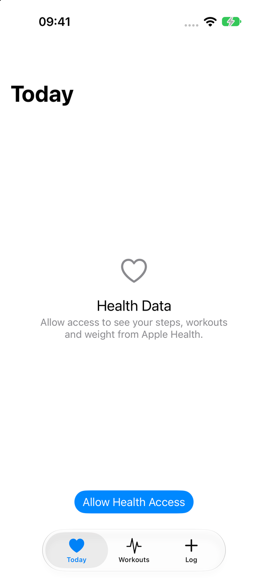
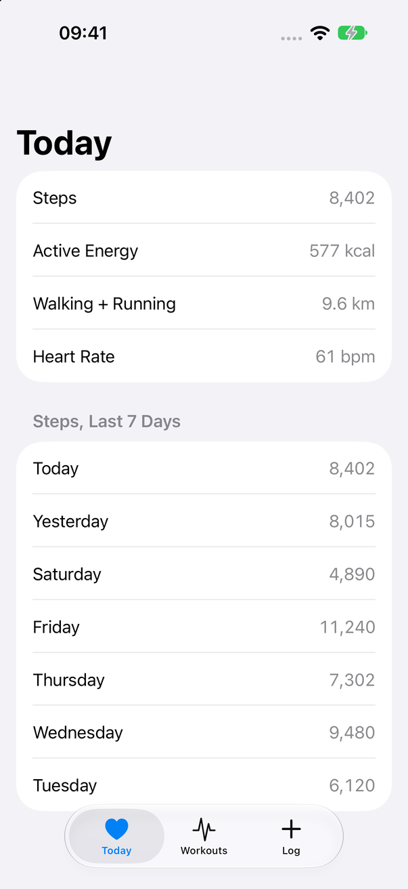
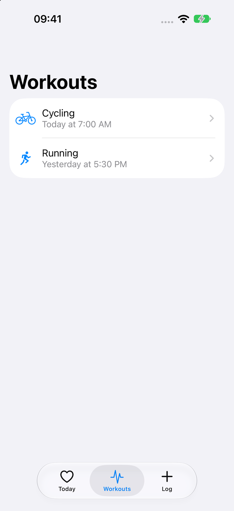
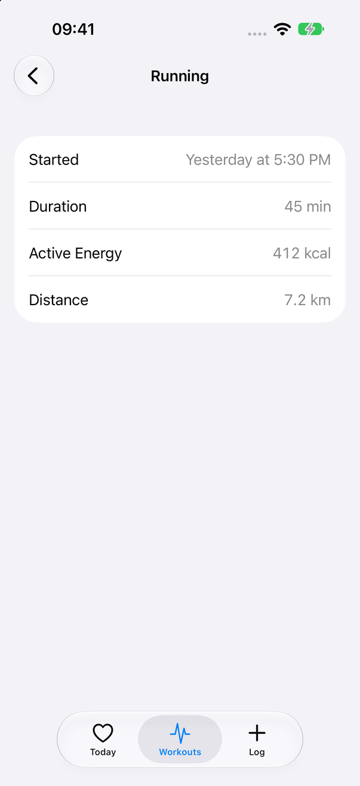
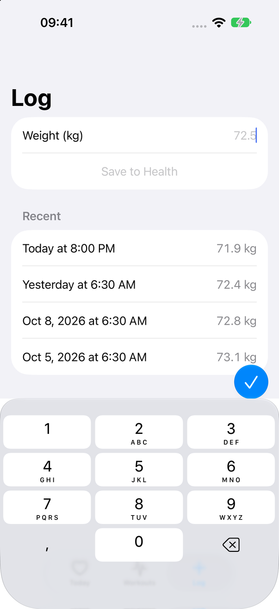

# HealthKit Exact

An [Exact](https://github.com/expo/exact) app using
[`@kingstinct/exact-healthkit`](../../packages/exact-healthkit), the Exact
counterpart of `apps/example` for the React Native package. It has three tabs:

- **Today:** today's steps, active energy, walking and running distance, and the
  latest heart rate, plus steps for each of the last 7 days.
- **Workouts:** workouts, newest first; each opens its duration, energy and
  distance.
- **Log:** save a body weight to Health and see the last ones.

| Before access | Today | Workouts | A workout | Log |
| --- | --- | --- | --- | --- |
|  |  |  |  |  |

Screenshots: iPhone 18 Pro simulator, under Exact's agent over the package's
fixture.

Nothing is read until the person allows Health access. Reads are live, so a save
here or a change in the Health app shows without a refresh.

`app.contract` is the view and `app.ts` the data module, which calls the
package's names from data code. Time comes in as source arguments from
`exactTime()`, as Exact requires.

## Run it

The app finds Exact at `../../../exact`, a checkout of
[expo/exact](https://github.com/expo/exact) next to this repository; set `EXACT`
to use another. Set the checkout up once (`bun scripts/exact.mjs setup` there),
then, from this directory:

```sh
bun install
bun exact.mjs ios --run      # build, install and launch on an iOS simulator
```

The example is not part of the root Bun workspace: Exact builds a package only
from the app's own `node_modules`, so it installs
`@kingstinct/exact-healthkit` with `file:`.

## Test it

Under Exact's agent the package answers from its fixture
(`packages/exact-healthkit/fixture/health.json`, 6–13 October 2026), so the
tests are deterministic:

```sh
bun exact.mjs test ios        # app.test.contract: what shows before access is allowed
bun test/drive.mjs            # agent drives: Today, Workouts and Log once allowed
```

A `.test.contract` cannot answer HealthKit's permission ticket, so the flows
after it are agent drives in `test/drive.mjs`.
